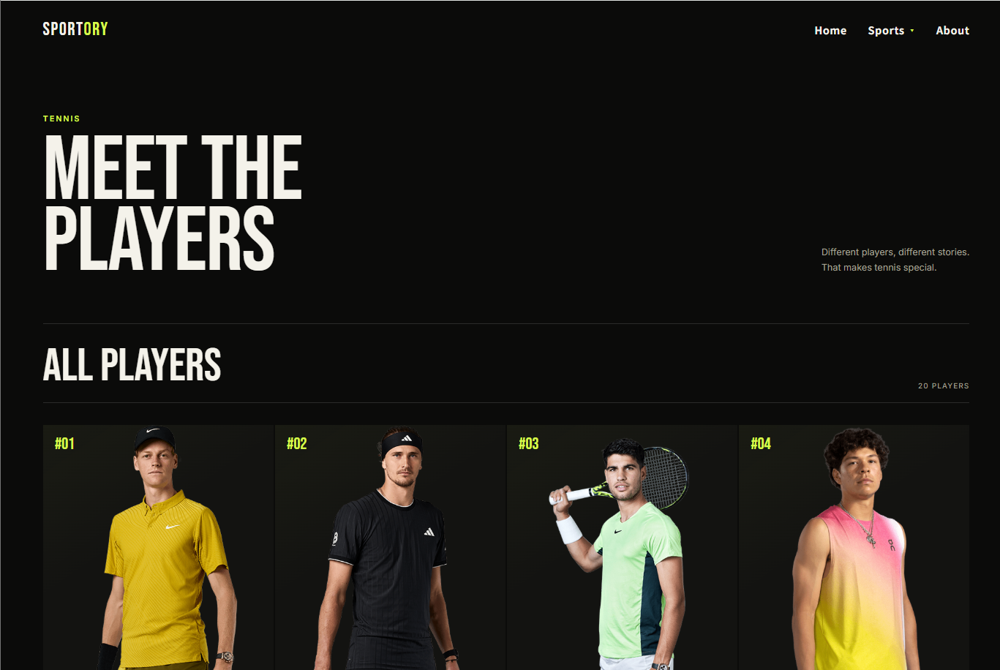
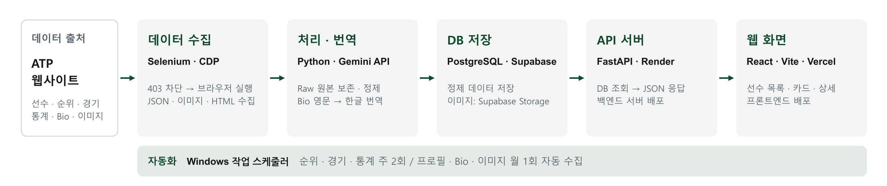
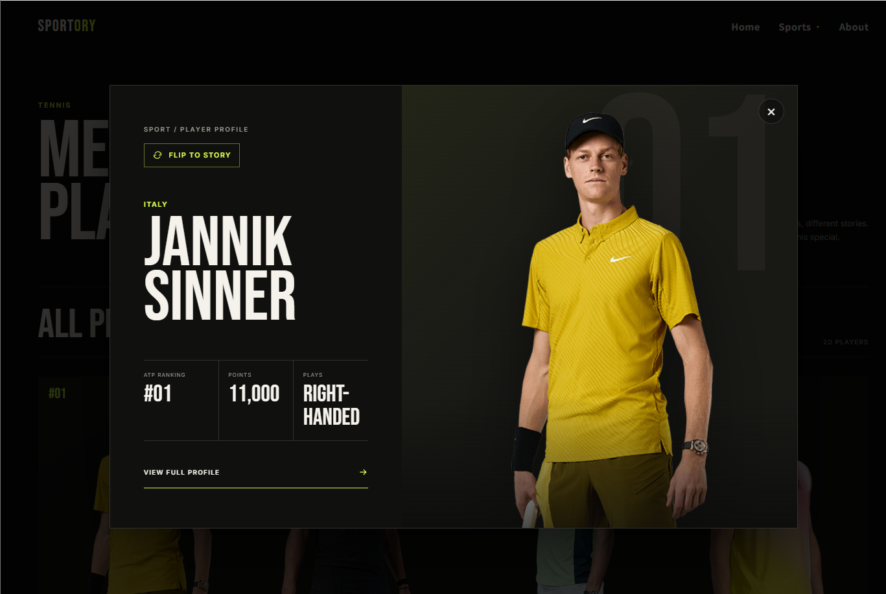
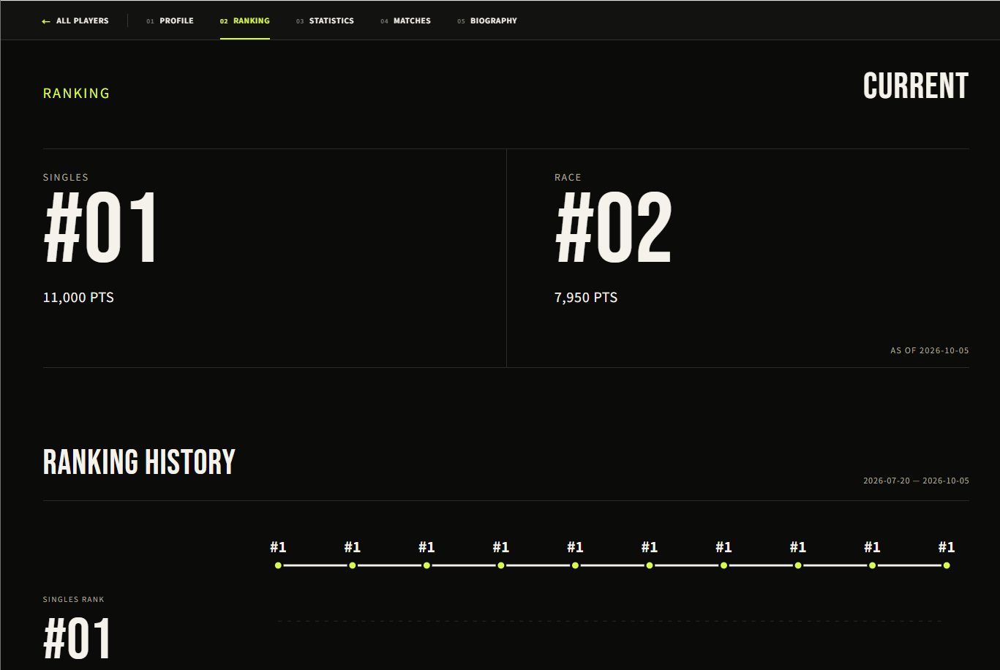
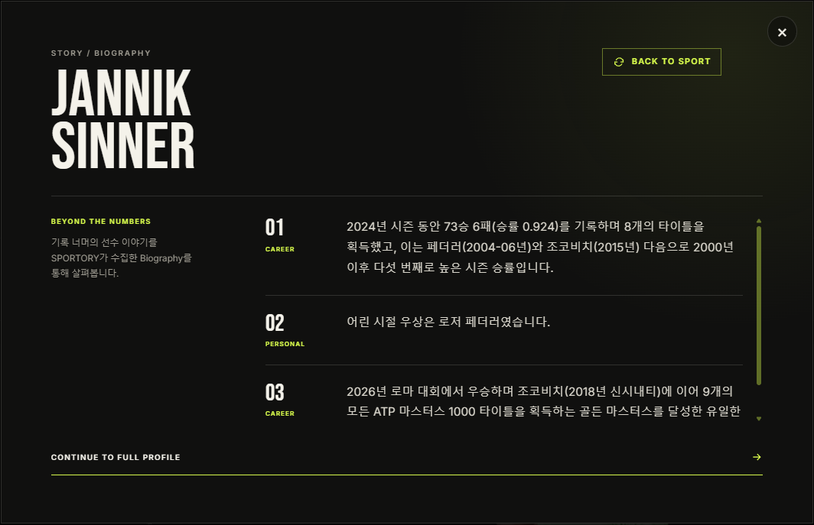
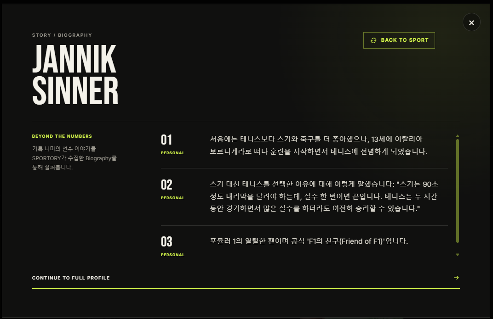

# SPORTORY

> **크롤링 기반 풀스택 웹서비스** — ATP 테니스 선수 데이터 수집부터 DB · API · 웹 화면 · 배포까지 1인 구축

**[서비스 바로가기](https://sportory.vercel.app/tennis/players)** · [데이터 파이프라인](#아키텍처) · [문제 해결](#문제-해결) · [실행 방법](#실행-방법)



| 구분 | 내용 |
| --- | --- |
| 유형 | 개인 프로젝트 |
| 기간 | 2026.09 – 2026.10 (1개월) |
| 수행 범위 | 기획 · 데이터 수집 · DB 설계 · 백엔드 · 프론트엔드 · 배포 · 자동화 |
| 데이터 출처 | [ATP](https://www.atptour.com) (Association of Tennis Professionals · 남자 프로 테니스 투어 운영 단체) 공식 웹사이트 |

## 기획 의도

- 선수 기록 · 경기 정보 → 제공 채널 다수
- 선수 개인 정보 · 이야기 → 제공 채널 부족
- → 선수 기록과 Biography(이야기)를 한 곳에서 보는 서비스

## 아키텍처



## 기술 스택 · 사용 용도

| 구분 | 기술 | 사용 용도 |
| --- | --- | --- |
| 데이터 수집 | Python · Selenium · CDP | 403 차단 → 브라우저 실행 · Network Response(JSON) · HTML 수집 |
| 데이터 처리 | Python | Raw 원본 보존 · 필드 매핑 · 정제 · 구조화 |
| 번역 | Gemini API (3.1 Flash-Lite) | Biography 영문 → 한글 번역 · 변경 시에만 실행 |
| DB | PostgreSQL · Supabase | 정제 데이터 저장 · UPSERT로 중복 저장 방지 |
| 백엔드 | FastAPI · Render | DB 조회 API · JSON 응답 · 서버 배포 |
| 프론트엔드 | React · Vite · Vercel | 선수 목록 · 카드 · 상세 화면 · 배포 |
| 자동화 | Windows 작업 스케줄러 | 데이터별 수집 주기 자동 실행 |

## 핵심 구현

### 1. 데이터 위치별 수집 방식 분리

| 데이터 | 수집 방식 | 수집 주기 | 코드 |
| --- | --- | --- | --- |
| Profile | Network Response (JSON) | 월 1회 | [collect_player_overview.py](crawler/collect_player_overview.py) |
| Ranking | Network Response (JSON) | 주 2회 | [collect_player_ranking_history.py](crawler/collect_player_ranking_history.py) |
| Matches | Network Response (JSON) | 주 2회 | [collect_player_activity.py](crawler/collect_player_activity.py) |
| Statistics | Network Response (JSON) | 주 2회 | [collect_player_stats.py](crawler/collect_player_stats.py) |
| Image | Network Response (PNG) | 월 1회 | [collect_player_image.py](crawler/collect_player_image.py) |
| Biography | HTML 요소 | 월 1회 | [collect_player_bio.py](crawler/collect_player_bio.py) |

- 개발자 도구로 화면 데이터의 위치 확인 → API 응답은 CDP로 Response Body 수집, 응답에 없는 Biography는 HTML에서 추출
- 변경 빈도별 수집 주기 차등 → 불필요한 반복 수집 방지

### 2. Raw 원본 보존 → 재수집 없이 재처리

- 수집 응답을 `raw_data` 테이블에 원본 그대로 저장
- 함께 기록: 출처 · URL · 선수 ID · 수집 시각 · 수집 방식
- 정제 로직 변경 · 오류 확인 시 원본 기준 재처리
- 코드: [save_raw_to_db.py](crawler/save_raw_to_db.py)

### 3. 정제 · 구조화 · UPSERT

- 외부 필드 → 서비스 스키마 매핑 (예: 생년월일 시각 제거, 중첩 객체 → 단일 값)
- 키 기준 `INSERT ... ON CONFLICT` → 재수집 시 중복 없이 갱신
- 코드: [save_player_to_db.py](crawler/save_player_to_db.py) · [save_matches_to_db.py](crawler/save_matches_to_db.py)

### 4. LLM 번역 · 결과 검증

- 기존 DB Bio와 새 Raw Bio 비교 → 변경된 경우에만 번역 ([check_bio_changed.py](crawler/check_bio_changed.py))
- Personal · Career 섹션 단위 일괄 번역, JSON 응답 스키마 지정 ([translate_player_bio.py](crawler/translate_player_bio.py))
- 검증: `item_order` 기준 원문 ↔ 번역 재연결 · 원문 · 번역 개수 일치 · 누락 확인

### 5. API

| Method | Endpoint | 설명 |
| --- | --- | --- |
| GET | `/players` | 선수 목록 + 최신 순위 · 점수 |
| GET | `/players/{player_id}` | 선수 상세 정보 · 이미지 URL |
| GET | `/players/{player_id}/bio` | Biography (영문 · 한글) |
| GET | `/players/{player_id}/rankings` | 순위 이력 |
| GET | `/players/{player_id}/stats` | 통계 |
| GET | `/players/{player_id}/matches` | 경기 · 대회 정보 |

- 코드: [backend/routers/players.py](backend/routers/players.py)

### 6. DB 테이블

| 테이블 | 역할 |
| --- | --- |
| `raw_data` | 수집 원본 · 수집 정보 |
| `players` | 선수 기본 정보 |
| `player_images` | 선수 이미지 경로 |
| `player_ranking_history` | 순위 · 점수 이력 |
| `player_stats` | 선수 통계 |
| `matches` · `tournaments` | 경기 · 대회 정보 |
| `player_bios` | Biography 원문 · 번역 |

## 문제 해결

| 문제 | 해결 |
| --- | --- |
| `requests`로 ATP 요청 시 `403 Forbidden` | Selenium 브라우저 실행 + CDP Network Response 수집으로 전환 |
| GitHub Actions에서 Stats 응답 수집 실패 → Python `schedule`은 스크립트 상시 실행 필요 | Windows 작업 스케줄러로 전환 |
| 재수집할 때마다 같은 Bio 반복 번역 | 기존 Bio와 비교 → 변경된 경우에만 Gemini 번역 |
| 선수 목록 조회 후 선수마다 `/rankings` 추가 요청 | `/players` 응답에 최신 ranking · points 포함 → 추가 호출 제거 ([커밋](https://github.com/Jenny5789/SPORTORY/commit/2566428)) |

## 화면

| 선수 카드 (앞면 · 뒷면) | 순위 이력 |
| --- | --- |
|  |  |

| Biography Story | Biography Story |
| --- | --- |
|  |  |

## 실행 방법

**환경 변수** (`.env`, 저장소 미포함)

```env
DB_HOST=
DB_PORT=
DB_NAME=
DB_USER=
DB_PASSWORD=
GEMINI_API_KEY=
```

**백엔드**

```bash
pip install -r requirements.txt
uvicorn backend.main:app --reload
```

**프론트엔드** (`VITE_API_BASE_URL` 미설정 시 `http://127.0.0.1:8000`)

```bash
cd frontend
npm install
npm run dev
```

**데이터 수집**

```bash
python crawler/get_players_from_db.py      # 주 2회: Ranking · Matches · Statistics
python crawler/run_monthly_player_data.py  # 월 1회: Profile · Bio · Image
```

## 폴더 구조

```text
SPORTORY/
├── crawler/            # 수집 · Raw 저장 · 정제 · 번역 스크립트
│   └── experiments/    # 수집 방식 검증용 테스트 코드
├── backend/            # FastAPI (main.py · routers/)
├── frontend/           # React · Vite
├── docs/               # 자동화 · 선수 추가 가이드, 화면 캡처
└── requirements.txt
```

## 회고 · 배운 점

- **브라우저 기반 데이터 수집**: 접근 차단 원인 확인 → 수집 방식 전환, 데이터 위치(JSON · HTML)별 수집 방식 설계
- **데이터 파이프라인 설계**: 원본 보존 · 정제 단계 분리 → 재처리 가능한 구조
- **LLM API 활용**: 응답 스키마 지정 · 결과 검증 · 변경 감지로 호출 최소화
- **풀스택 · 배포 · 운영**: FastAPI · React 연동, API 응답 구조 개선, Render · Vercel · Supabase 배포, 수집 자동화
