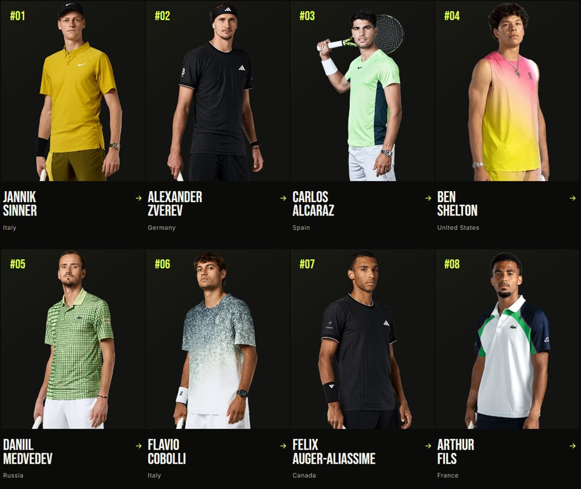
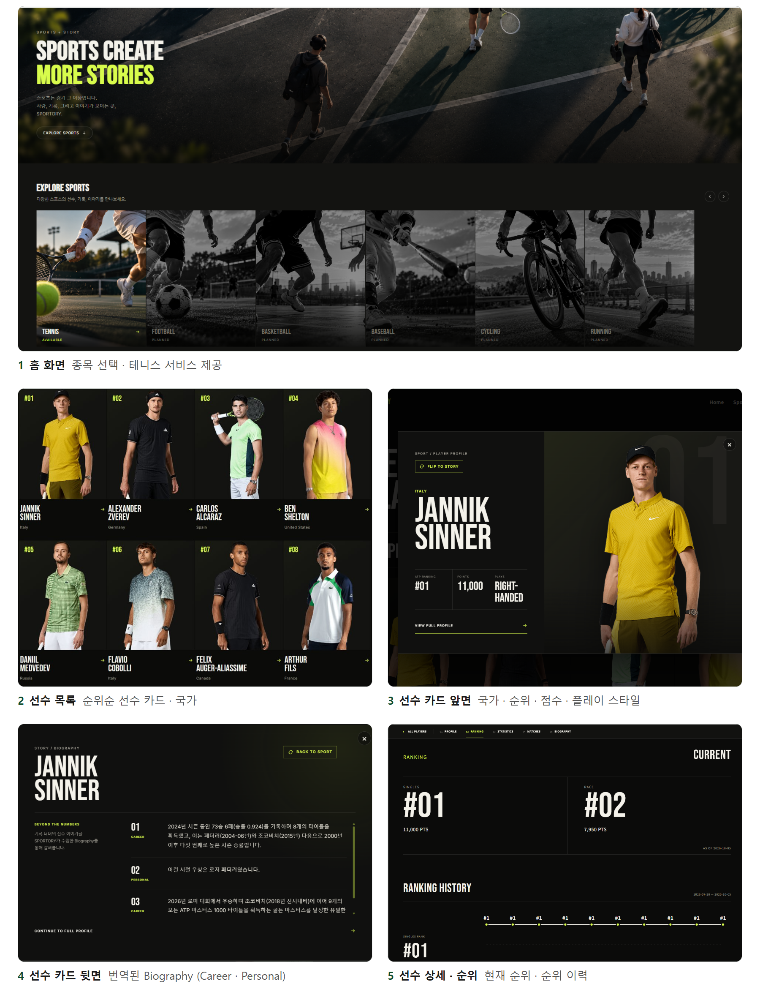
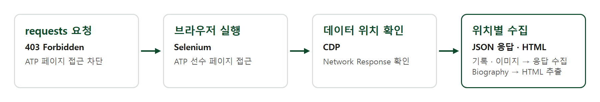
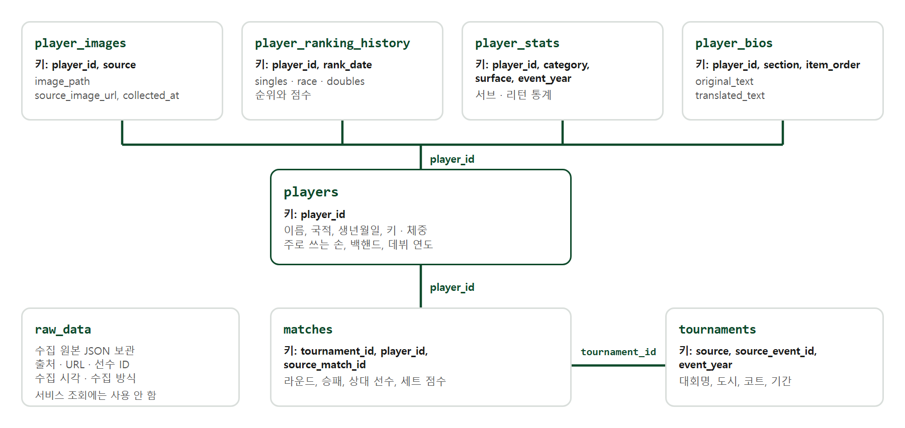
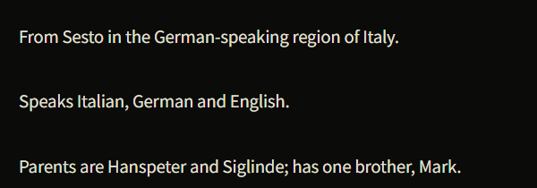
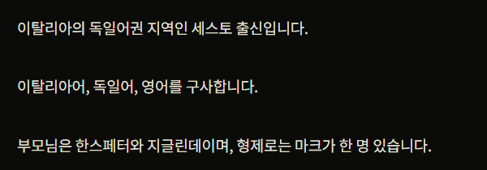
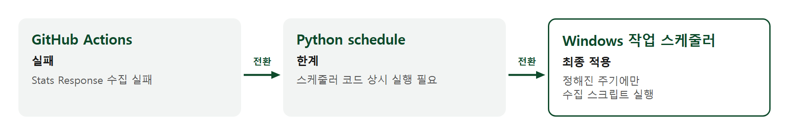
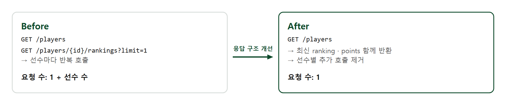

<div align="center">

# SPORTORY

크롤링·FastAPI·PostgreSQL·REST API로 구현한 **풀스택 웹 서비스**

`Python` · `Selenium + CDP` · `PostgreSQL (Supabase)` · `Gemini 3.1 Flash-Lite` · `FastAPI` · `React 19` · `Vite 8`

<br />



</div>

---

## 1. 프로젝트 개요

- **배경:** 경기 일정과 순위는 제공처가 많으나 선수 Biography는 분산
- **목표:** ATP 선수 기록과 Biography를 한 서비스에서 제공
- **기간:** 2026.09 – 2026.10 (3주)
- **역할:** 개인 프로젝트 (기획, 데이터 수집, DB 설계, 백엔드, 프론트엔드, 배포, 자동화)
- **규모:** 선수 20명, DB 테이블 8개, REST API 6개
- **데이터 출처:** ATP 공식 웹사이트 (남자 프로 테니스 투어)

| 영역 | 기술 | 용도 |
| --- | --- | --- |
| 데이터 수집 | Python, Selenium, CDP Network 로그 | `requests` `403` 차단으로 브라우저 수집 |
| 번역 | Gemini API (3.1 Flash-Lite, `google-genai`) | Biography 영한 번역, Structured Output |
| DB, 저장소 | PostgreSQL (Supabase), Supabase Storage, psycopg | 원본, 정제 데이터, 선수 이미지 저장 |
| 백엔드 | FastAPI, Uvicorn, Render | DB 조회 REST API |
| 프론트엔드 | React 19.3, Vite 8.3, React Router 7.18, Vercel | 선수 목록, 카드, 상세 화면 |
| 자동화 | Windows 작업 스케줄러 | 데이터별 주기 수집 |
| 개발 도구 | VS Code, Git, GitHub, Anaconda | 개발 환경, 버전 관리, Python 가상 환경 |

---

## 2. 서비스 구조

<p align="center">
  
</p>

- **데이터 수집 흐름:** 작업 스케줄러 실행 → 수집 → 원본 저장 → 정제와 번역 → Supabase 저장
- **서비스 요청 흐름:** 웹 화면 → FastAPI → DB (DB 접근은 API 서버만)

---

## 3. 주요 화면

<p align="center">
  
</p>

---

## 4. 주요 기능

### 4-1. 데이터 수집

- **이유:** `requests` `403` 차단, HTML 파싱은 레이아웃 변경에 취약, 데이터 대부분이 API 응답(JSON)에 존재
- **과정:** 개발자 도구로 데이터 출처 확인, `requests`, Playwright, Selenium 비교

<p align="center">
  
</p>

- **결과:** 5종(프로필, 순위, 경기, 통계, 이미지) JSON 응답 수집, Biography만 HTML 추출

<details>
<summary>데이터별 확인 경로</summary>

<br />

| 데이터 | 확인 경로 | 형태 |
| --- | --- | --- |
| Profile | `/players/hero/{player_id}` | JSON |
| Ranking | `/rank/history/{player_id}` | JSON |
| Matches | `/activity/sgl/{player_id}/` | JSON |
| Statistics | `/stats/{player_id}/all/all` | JSON |
| Image | `player-gladiator-headshot/{player_id}` | PNG |
| Biography | `.atp_player-bio .tabs` | HTML |

</details>

<details>
<summary>코드: CDP Network 로그에서 API 응답 추출</summary>

<br />

[collect_player_stats.py](crawler/collect_player_stats.py)

```python
options.set_capability("goog:loggingPrefs", {"performance": "ALL"})   # Network 로그 활성화
driver = webdriver.Chrome(options=options)
driver.execute_cdp_cmd("Network.enable", {})

driver.get(stats_page_url)
performance_logs = driver.get_log("performance")

for log in performance_logs:
    message = json.loads(log["message"])["message"]
    if message["method"] != "Network.responseReceived":
        continue

    response = message["params"]["response"]
    if target_pattern not in response.get("url", ""):         # 통계 API 응답만 필터링
        continue

    body_result = driver.execute_cdp_cmd(                      # requestId로 응답 본문 조회
        "Network.getResponseBody",
        {"requestId": message["params"]["requestId"]}
    )
    stats_data = json.loads(body_result["body"])
    break
# (base64 디코딩, 예외 처리, 로그 출력 생략)
```

</details>

### 4-2. 데이터 처리와 저장

- **이유:** 정제 규칙 변경 시 재수집 없는 재처리, 반복 수집 시 중복 없는 저장(멱등성) 필요

<p align="center">
  
</p>

**테이블 관계와 UPSERT 키**

<p align="center">
  
</p>

- **결과:** 원본 기준 재처리, UPSERT 키로 멱등성 확보

### 4-3. Biography 번역

- **이유:** 영문 원문만 제공, 변경 없는 원문 재번역 시 API 비용 낭비

<p align="center">
  
</p>

- **결과:** 영문, 한글 Biography 제공, 변경 없는 원문은 Gemini 호출 생략

| 영어 (수집 원문) | 한국어 (Gemini 번역) |
| --- | --- |
|  |  |

<details>
<summary>코드: Gemini 응답 형식 고정(Structured Output)과 검증</summary>

<br />

[translate_player_bio.py](crawler/translate_player_bio.py), [check_bio_changed.py](crawler/check_bio_changed.py)

```python
response = client.models.generate_content(
    model="gemini-3.1-flash-lite",
    contents=prompt,
    config=types.GenerateContentConfig(
        temperature=0.2,
        response_mime_type="application/json",
        response_schema={                                    # 응답 스키마 고정
            "type": "ARRAY",
            "items": {
                "type": "OBJECT",
                "properties": {
                    "item_order": {"type": "INTEGER"},
                    "translated_text": {"type": "STRING"}
                },
                "required": ["item_order", "translated_text"]
            }
        }
    )
)

translated_items = json.loads(response.text)

if len(translated_items) != len(texts):                      # 누락 검증
    raise ValueError(f"원문 {len(texts)}개 / 번역 {len(translated_items)}개")

translated_by_order = {                                      # item_order 기준 재매핑
    item["item_order"]: item["translated_text"]
    for item in translated_items
}
```

</details>

### 4-4. 자동 수집

- **이유:** 데이터별 변경 빈도 차이 (순위, 경기, 통계 잦음 / 프로필, Biography, 이미지 드묾)
- **결과:** 순위, 경기, 통계 주 2회 / 프로필, Biography, 이미지 월 1회

---

## 5. 문제 해결

### 1) 수집: ATP 요청 `403 Forbidden`

- **문제:** `requests` 요청 시 `403` 응답
- **원인 분석:** 응답 상태 코드와 본문 출력으로 비브라우저 요청 차단 확인
- **해결:** Selenium 브라우저 실행, CDP Network 로그로 응답 수집
- **결과:** 5종 데이터 JSON 수집

### 2) 자동화: GitHub Actions에서 통계 응답 수집 실패

- **문제:** 통계 응답이 GitHub Actions에서만 미수집
- **원인 분석:** 응답 URL 로그 추가, Chrome 실행 옵션 조정으로 원인 범위 축소 시도
- **해결:** Windows 작업 스케줄러로 전환 (Python `schedule`은 상시 실행 필요로 제외)
- **결과:** 주 2회, 월 1회 자동 수집

<p align="center">
  
</p>

### 3) 번역: 변경 없는 Biography 반복 번역

- **문제:** 월 1회 재수집 시 동일 원문 재번역
- **원인 분석:** 원문 변경 여부와 무관하게 번역 단계 실행
- **해결:** 기존 원문과 섹션별 비교 후 변경 시에만 번역
- **결과:** 변경 없는 원문은 Gemini 호출 생략

### 4) API: 선수 목록 화면 N+1 요청

- **문제:** 목록 조회 후 선수마다 `/rankings?limit=1` 추가 요청
- **원인 분석:** 목록 API에 최신 순위 미포함
- **해결:** `/players` 응답에 최신 순위와 점수 추가 ([커밋](https://github.com/Jenny5789/SPORTORY/commit/2566428))
- **결과:** 요청 N+1회 → 1회, 프론트엔드 선수별 요청 코드 삭제

<p align="center">
  
</p>

---

## 6. 한계와 개선 방향

- **로컬 스케줄러:** PC 종료 시 수집 중단, 클라우드 스케줄러 필요
- **수집 대상 확대:** 선수 추가 절차 문서화, 선수 수에 비례해 수집 시간 증가
- **테스트 없음:** ATP 응답 형식 변경을 감지할 정제, 매핑 함수 단위 테스트 필요

---

<details>
<summary><b>API 목록</b></summary>

<br />

| Method | Endpoint | 설명 |
| --- | --- | --- |
| GET | `/players` | 선수 목록, 최신 순위와 점수 |
| GET | `/players/{player_id}` | 선수 상세 정보, 이미지 URL |
| GET | `/players/{player_id}/bio` | Biography (영문, 한글) |
| GET | `/players/{player_id}/rankings` | 순위 이력 |
| GET | `/players/{player_id}/stats` | 통계 |
| GET | `/players/{player_id}/matches` | 경기와 대회 정보 |

</details>

<details>
<summary><b>실행 방법과 폴더 구조</b></summary>

<br />

**환경 변수** (`.env`, 저장소 미포함)

```env
DB_HOST=
DB_PORT=
DB_NAME=
DB_USER=
DB_PASSWORD=
GEMINI_API_KEY=
```

**백엔드**

```bash
pip install -r requirements.txt
uvicorn backend.main:app --reload
```

**프론트엔드** (`VITE_API_BASE_URL` 미설정 시 `http://127.0.0.1:8000`)

```bash
cd frontend
npm install
npm run dev
```

**데이터 수집**

```bash
python crawler/get_players_from_db.py      # 주 2회: Ranking, Matches, Statistics
python crawler/run_monthly_player_data.py  # 월 1회: Profile, Bio, Image
```

```text
SPORTORY/
├── crawler/            # 수집, 원본 저장, 정제, 번역 스크립트
│   └── experiments/    # 수집 방식 검증용 테스트 코드
├── backend/            # FastAPI (main.py, routers/)
├── frontend/           # React, Vite
├── docs/               # README 이미지, 도식 원본(diagrams/), 가이드
└── requirements.txt
```

</details>

---

## 7. 프로젝트를 통해 얻은 경험

- **데이터 소스 분석:** 개발자 도구로 화면 데이터 위치(API 응답, HTML) 확인 후 수집 방식 결정
- **브라우저 수집:** Selenium, CDP Network 로그로 JSON 응답 수집, `403` 차단 우회
- **ELT 파이프라인:** 원본 적재, 정제, UPSERT 단계 분리로 재처리 가능한 구조 구현
- **LLM 연동:** Structured Output(JSON Schema)으로 응답 형식 고정, 개수와 순서 검증, 변경된 원문만 번역
- **REST API 설계:** 화면 단위 응답 설계(`/players`에 최신 순위 포함)로 N+1 요청 제거
- **배포와 운영:** Supabase, Render, Vercel 배포, Windows 작업 스케줄러 자동 수집

---

<div align="center">

### SPORTORY

**사람, 기록, 그리고 이야기가 모이는 곳.**

</div>
