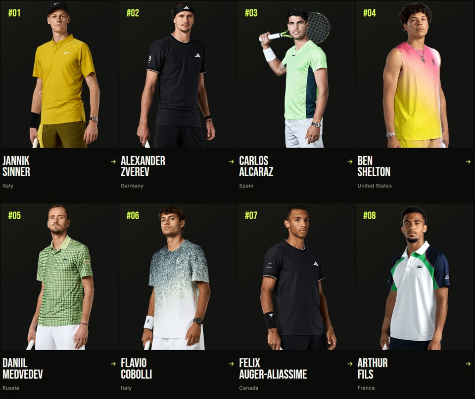
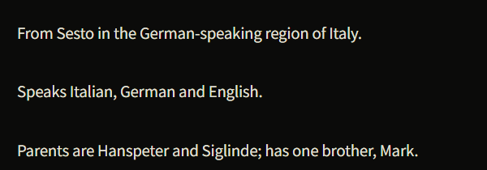
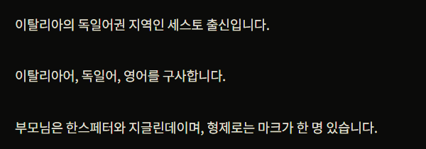

# SPORTORY &nbsp;&nbsp;&nbsp;&nbsp;&nbsp;<sup><sub>2026.09</sub></sup>

Selenium · CDP로 ATP 선수 데이터를 수집해 DB · API · 웹 화면 · 배포 · 자동화까지 1인으로 구축한 풀스택 데이터 서비스.

**[🔗 서비스 바로가기](https://sportory.vercel.app/tennis/players)** · [설계 의도](#설계-의도) · [진행 과정](#진행-과정) · [문제 해결](#문제-해결)




## 개요

- **문제**
  - 경기 일정 · 순위: 여러 사이트에서 쉽게 확인 가능
  - 선수 Biography: 분산되어 한눈에 모아보기 어려움
- **해결**
  - 스크래핑으로 필요한 정보를 수집해 한 곳에서 제공하는 웹 서비스 구현
  - 브라우저가 받는 JSON 응답 수집 → 원본 DB 저장 → 정제
  - Biography: 원문 변경 시에만 한국어 번역
- **결과**
  - 경기 일정 · 순위 · Biography를 한 곳에서 조회
  - 선수 목록 요청 N+1회 → 1회로 단축
  - 선수 20명 데이터 운영 중

## 한눈에 보기

| 항목 | 내용 |
|---|---|
| 역할 | 1인 · 기획, 데이터 수집, DB 설계, 백엔드, 프론트엔드, 배포, 자동화 |
| 기간 | 2026.09 – 2026.10 (3주) |
| 규모 | 선수 20명 · DB 테이블 8개 · REST API 6개 |
| 배포 | DB Supabase · API Render · 웹 Vercel |

### 핵심 역량

1. **데이터 소스 분석**: 개발자 도구로 화면 데이터의 출처(API 응답 · HTML)를 파악해 수집 방식 설계
2. **브라우저 기반 수집**: Selenium + CDP Network 로그로 API 응답(JSON) 수집, 봇 차단(403) 대응
3. **ELT 파이프라인**: Raw 적재 → 정제 · 정규화 → UPSERT, 원본 기반 재처리 구조
4. **LLM 연동**: 변경 감지로 호출 최소화, Structured Output(JSON Schema)과 응답 검증
5. **서빙 · 운영**: REST API 설계(N+1 제거), Supabase · Render · Vercel 배포, 스케줄링 자동화

## 아키텍처


## 설계 의도

5개 핵심 결정을 **문제 → 방법** 순으로 정리

### 1. 수집: 화면 HTML 대신 JSON 응답 수집

- **문제**
  - `requests` 요청 시 `403 Forbidden` 차단
  - 화면 HTML 파싱은 레이아웃 변경에 취약
- **방법**
  - Selenium 실행 → CDP 네트워크 로그에서 JSON 응답 추출
  - JSON에 없는 Biography만 HTML 파싱
- **결과**: 프로필 · 순위 · 경기 · 통계 · 이미지 5종을 JSON으로 수집

### 2. 저장: 원본 우선 적재, 정제는 후속 처리

- **문제**: 수집 즉시 정제하면 정제 규칙 변경 시 재수집 필요
- **방법**: `raw_data`에 출처 · URL · 선수 ID · 수집 시각과 함께 원본 적재 후 정제
- **결과**: 정제 규칙이 바뀌어도 재수집 없이 원본으로 재처리 가능

### 3. 갱신: 데이터별 주기 수집 + UPSERT

- **문제**: 데이터마다 갱신 주기가 다름 (순위 주 단위, 프로필 · Biography 변경 빈도 낮음)
- **방법**
  - 순위 · 경기 · 통계: 주 2회 / 프로필 · 이미지 · Biography: 월 1회
  - 키 기준 UPSERT(있으면 갱신, 없으면 추가) → 재실행해도 결과 동일
- **결과**: 순위 · 경기 · 통계 주 2회, 프로필 · Biography 월 1회 자동 수집 운영

### 4. 번역: 변경 감지 + 구조화 응답 + 검증

- **문제**: 월 1회 재수집 시 변경 없는 원문도 반복 번역 → API 비용 낭비
- **방법**
  - 기존 · 신규 원문 섹션별 비교 → 변경 시에만 Gemini 호출
  - JSON Schema로 응답 형식 고정
  - 원문 · 번역 개수 검증, `item_order`로 순서 재매핑
- **결과**: 변경 없는 선수는 Gemini 호출 생략

### 5. API: 화면 단위 응답 설계

- **문제**: 목록 조회 후 선수마다 순위를 재요청 (N+1 요청)
- **방법**: `/players` 응답에 최신 순위 · 점수 포함
- **결과**: 목록 화면 요청 N+1회 → 1회

## 진행 과정

| 단계 | 작업 | 검증 |
|---|---|---|
| 1. 데이터 소스 분석 | 개발자 도구로 데이터 출처 파악, `requests` · Playwright · Selenium 비교 실험 | 403 차단 확인, CDP로 JSON 응답 확보 |
| 2. 파이프라인 구축 | Raw 적재 → 정제 → UPSERT, 수집기 일반화 | 선수 ID만 바꿔 동일 수집기로 다수 선수 수집 |
| 3. API 개발 | FastAPI REST API 6개 | 화면별 필요 응답 구조 정의 |
| 4. 프론트엔드 | React 선수 목록 · 카드 · 상세 화면 | API 연동, 카드 앞뒤 · Biography Story |
| 5. 배포 | Supabase · Render · Vercel, CORS 설정 | 배포 환경 화면 · API 연결 |
| 6. 자동화 | Windows 작업 스케줄러 | 주 2회 · 월 1회 자동 수집 |
| 7. 개선 | N+1 요청 제거, SPA 라우팅 설정 | 목록 화면 요청 1회로 감소 |

## 핵심 코드

### CDP Network 로그에서 API 응답 추출

[collect_player_stats.py](crawler/collect_player_stats.py)

```python
options.set_capability("goog:loggingPrefs", {"performance": "ALL"})   # Network 로그 활성화
driver = webdriver.Chrome(options=options)
driver.execute_cdp_cmd("Network.enable", {})

driver.get(stats_page_url)
performance_logs = driver.get_log("performance")

for log in performance_logs:
    message = json.loads(log["message"])["message"]
    if message["method"] != "Network.responseReceived":
        continue

    response = message["params"]["response"]
    if target_pattern not in response.get("url", ""):         # 통계 API 응답만 필터링
        continue

    body_result = driver.execute_cdp_cmd(                      # requestId로 응답 본문 조회
        "Network.getResponseBody",
        {"requestId": message["params"]["requestId"]}
    )
    stats_data = json.loads(body_result["body"])
    break
# (base64 디코딩, 예외 처리, 로그 출력 생략)
```

### LLM Structured Output과 응답 검증

[translate_player_bio.py](crawler/translate_player_bio.py) · [check_bio_changed.py](crawler/check_bio_changed.py)

```python
response = client.models.generate_content(
    model="gemini-3.1-flash-lite",
    contents=prompt,
    config=types.GenerateContentConfig(
        temperature=0.2,
        response_mime_type="application/json",
        response_schema={                                    # 응답 스키마 고정
            "type": "ARRAY",
            "items": {
                "type": "OBJECT",
                "properties": {
                    "item_order": {"type": "INTEGER"},
                    "translated_text": {"type": "STRING"}
                },
                "required": ["item_order", "translated_text"]
            }
        }
    )
)

translated_items = json.loads(response.text)

if len(translated_items) != len(texts):                      # 누락 검증
    raise ValueError(f"원문 {len(texts)}개 / 번역 {len(translated_items)}개")

translated_by_order = {                                      # item_order 기준 재매핑
    item["item_order"]: item["translated_text"]
    for item in translated_items
}
```

## 문제 해결

### 1. 수집: ATP 요청 `403 Forbidden`

- **현상**: `requests`로 페이지 요청 시 403 응답
- **원인 분석**: 응답 상태 코드 · 본문 출력으로 비브라우저 요청 차단 확인 ([test_atp_request.py](crawler/test_atp_request.py))
- **해결**: Selenium 브라우저 실행 + CDP Network 로그 기반 응답 수집으로 전환
- **결과**: 프로필 · 순위 · 경기 · 통계 · 이미지 5종 JSON 수집

### 2. 번역: 변경 없는 Biography 반복 번역

- **현상**: 월 1회 재수집마다 동일 원문 재번역
- **원인 분석**: 변경 여부와 무관하게 번역 단계 실행
- **해결**: 기존 원문과 섹션별 비교 후 변경 시에만 번역
- **결과**: 변경 없는 선수는 Gemini 호출 생략

### 3. 자동화: GitHub Actions에서 통계 응답 수집 실패

- **현상**: 로컬에서는 수집되던 통계 응답이 Actions 환경에서 미수집
- **원인 분석**: 응답 URL 로그 추가, Chrome 실행 옵션 조정으로 원인 범위 축소 시도
- **해결**: Windows 작업 스케줄러로 전환. 상시 실행이 필요한 Python `schedule` 방식도 제외
- **결과**: 주 2회 · 월 1회 자동 수집 운영

### 4. API: 선수 목록 화면 N+1 요청

- **현상**: 목록 조회 후 선수마다 `/rankings?limit=1` 추가 요청
- **원인 분석**: 목록 API가 화면에 필요한 최신 순위를 미포함
- **해결**: `/players` 응답에 최신 순위 · 점수 포함 ([커밋](https://github.com/Jenny5789/SPORTORY/commit/2566428))
- **결과**: 목록 화면 요청 N+1회 → 1회, 프론트엔드 요청 로직 단순화

## 결과 화면

| 선수 카드 (앞면) | 순위 이력 |
|---|---|
|  |  |

**Biography (원문 수집 → LLM 번역)**

| 영어 (수집 원문) | 한국어 (Gemini 번역) |
|---|---|
|  |  |

## 한계와 개선 방향

- **로컬 스케줄러 의존**: PC 종료 시 수집 중단 → 클라우드 스케줄링 필요
- **수집 대상 확장**: 선수 추가 절차는 [ADD_PLAYER_GUIDE.md](docs/ADD_PLAYER_GUIDE.md)로 정리, 대상 확대 시 수집 시간 증가 대응 필요
- **테스트 부재**: 정제 · 매핑 함수 단위 테스트로 외부 스키마 변경 조기 감지 필요

## 기술 스택

| 영역 | 기술 |
|---|---|
| 언어 | Python, JavaScript(JSX), HTML, CSS |
| 수집 | Selenium, Chrome DevTools Protocol(CDP) Network 로그 |
| 번역 | Google Gemini API (`google-genai`, Structured Output) |
| DB · 스토리지 | PostgreSQL, Supabase(Storage 포함), psycopg |
| 백엔드 | FastAPI, Uvicorn |
| 프론트엔드 | React 19, Vite 8, React Router 7, CSS(컴포넌트별 파일) |
| 자동화 | Windows 작업 스케줄러 |
| 배포 | Supabase · Render(API) · Vercel(웹) |

## 배운 점

- 수집 방식을 바꾸기 전에 응답을 직접 확인해 원인부터 특정하는 접근
- 원본 저장과 정제를 분리해 재처리 가능한 구조를 먼저 설계하는 것의 가치
- AI 번역 결과는 응답 형식 고정과 검증을 거쳐야 서비스 데이터로 쓸 수 있다는 점

<details>
<summary><b>API · DB 테이블</b></summary>

| Method | Endpoint | 설명 |
|---|---|---|
| GET | `/players` | 선수 목록 + 최신 순위 · 점수 |
| GET | `/players/{player_id}` | 선수 상세 정보 · 이미지 URL |
| GET | `/players/{player_id}/bio` | Biography (영문 · 한글) |
| GET | `/players/{player_id}/rankings` | 순위 이력 |
| GET | `/players/{player_id}/stats` | 통계 |
| GET | `/players/{player_id}/matches` | 경기 · 대회 정보 |

| 테이블 | 역할 |
|---|---|
| `raw_data` | 수집 원본 · 수집 정보 |
| `players` | 선수 기본 정보 |
| `player_images` | 선수 이미지 경로 |
| `player_ranking_history` | 순위 · 점수 이력 |
| `player_stats` | 선수 통계 |
| `matches` · `tournaments` | 경기 · 대회 정보 |
| `player_bios` | Biography 원문 · 번역 |

</details>

<details>
<summary><b>실행 방법 · 폴더 구조</b></summary>

**환경 변수** (`.env`, 저장소 미포함)

```env
DB_HOST=
DB_PORT=
DB_NAME=
DB_USER=
DB_PASSWORD=
GEMINI_API_KEY=
```

**백엔드**

```bash
pip install -r requirements.txt
uvicorn backend.main:app --reload
```

**프론트엔드** (`VITE_API_BASE_URL` 미설정 시 `http://127.0.0.1:8000`)

```bash
cd frontend
npm install
npm run dev
```

**데이터 수집**

```bash
python crawler/get_players_from_db.py      # 주 2회: Ranking · Matches · Statistics
python crawler/run_monthly_player_data.py  # 월 1회: Profile · Bio · Image
```

```text
SPORTORY/
├── crawler/            # 수집 · Raw 적재 · 정제 · 번역 스크립트
│   └── experiments/    # 수집 방식 검증용 테스트 코드
├── backend/            # FastAPI (main.py · routers/)
├── frontend/           # React · Vite
├── docs/               # 자동화 · 선수 추가 가이드, 화면 캡처
└── requirements.txt
```

</details>
