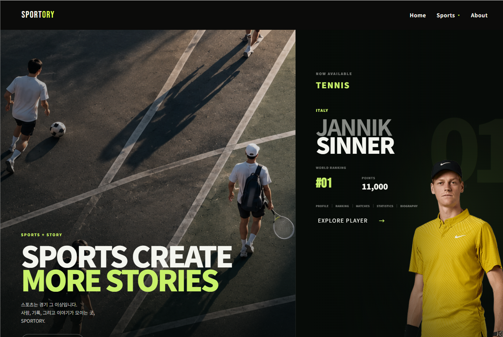
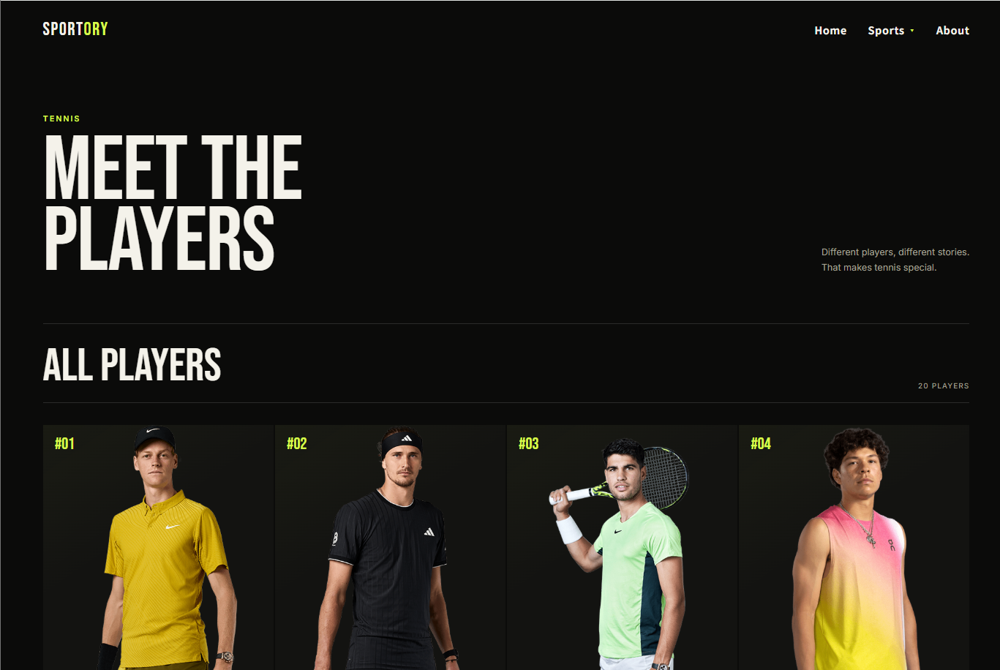
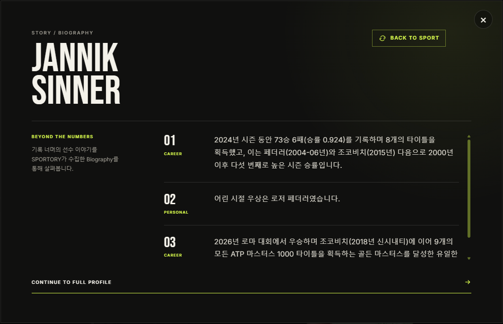
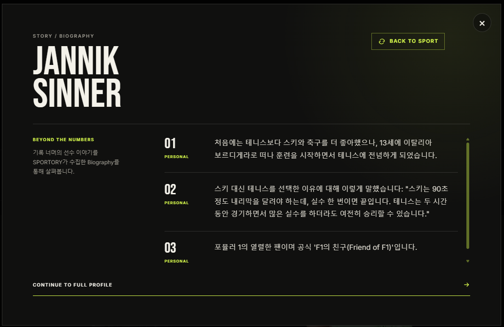
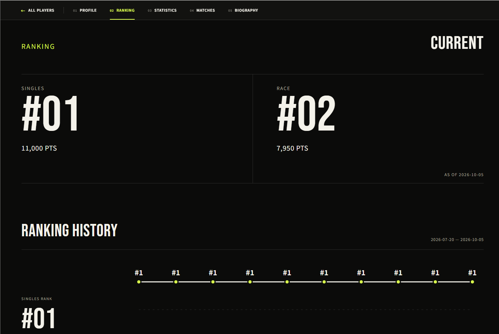

# SPORTORY

> 선수 기록과 Biography를 연결해 선수의 이야기를 제공하는 개인 프로젝트

- 스포츠 데이터를 기반으로 한 테니스 선수 정보 서비스
- 선수 기록, 순위, 경기, 통계, Biography 제공
- Biography 한국어 번역 제공
- 데이터 수집부터 웹 서비스까지 직접 구현

## Links

- [SPORTORY 바로가기](https://sportory.vercel.app/)
- [GitHub 저장소](https://github.com/Jenny5789/SPORTORY)

## Screenshots

### Home

- SPORTORY 서비스 소개
- 현재 제공 종목: Tennis



### Players

- 선수 목록
- 현재 순위 확인



### Player Profile and Story

- 카드 앞면: 선수 프로필과 주요 기록
- 카드 뒤집기: Biography Story 확인


### Random Biography Story

- Personal·Career Biography 항목 중 3개 랜덤 표시
- 같은 선수의 다양한 이야기 확인

<table>
  <tr>
    <td></td>
    <td></td>
  </tr>
</table>

### Ranking

- 현재 순위 확인
- 순위 이력 확인



## Project Overview

- 구현 종목: Tennis
- 수집 데이터:
  - 선수 기본 정보
  - 선수 이미지
  - ATP 단식 순위 및 순위 이력
  - 선수 경기 및 대회 정보
  - 선수 통계
  - Biography 원문
  - Biography 한국어 번역
- 사용자 흐름:

```text
Home → Tennis → Players → Player Detail
```

- Player Detail 제공 정보:
  - Profile
  - Ranking
  - Matches
  - Statistics
  - Biography

## Project Purpose

- 기록과 순위 중심의 스포츠 정보 확장
- 선수 기록과 Biography 연결
- 숫자만으로 알기 어려운 선수의 배경과 이야기 제공

## Data Pipeline

```text
ATP Web Source
      ↓
Data Collection
      ↓
Raw Data Storage
      ↓
Data Processing
      ↓
Biography Translation
      ↓
PostgreSQL
      ↓
FastAPI
      ↓
React Frontend
```

### 1. Data Collection

- ATP 페이지의 동적 데이터 수집
- 데이터 제공 형태에 따른 수집 방식 분리
- Profile, Ranking, Matches, Statistics, Image:
  - Network Response 기반 수집
- Biography:
  - HTML의 Personal·Career 영역 수집
- Selenium:
  - 브라우저 실행
  - 페이지 이동
  - 렌더링 대기
- CDP:
  - Network 이벤트 확인
  - Response Body 접근
- 문제 해결:
  - ATP 직접 요청 시 `403` 발생
  - 실제 브라우저 환경 기반 수집으로 전환

### 2. Raw Data Storage

- 수집 원본 응답 보존
- 함께 보존하는 메타데이터:
  - Source
  - Source URL
  - Source Player ID
  - Collection Time
  - Collection Method
  - Original JSON 또는 Content
- 활용:
  - 가공 결과 문제 확인
  - 원본 기준 재처리
  - 수집 재실행 없이 데이터 검증

### 3. Data Processing

- 외부 데이터 필드와 서비스 필드 매핑
- 날짜·국가·플레이 스타일 값 정제
- 서비스 스키마에 맞게 데이터 구조화

```text
Raw Data → Field Mapping → Data Cleaning → Service Schema → PostgreSQL
```

### 4. Biography Translation

- 사용 모델: Gemini 3.1 Flash-Lite
- 대상: SPORTORY가 수집한 Biography 영문 원문
- 번역 범위: Personal·Career
- 기존 Biography 변경 시에만 재번역
- 검증 항목:
  - `item_order`
  - 번역 결과 개수
  - 누락 여부
- 구조화 데이터는 일반 코드로 처리:
  - Ranking
  - Match
  - Statistics

### 5. Database and API

- 정제 데이터: PostgreSQL 저장
- 데이터 제공: FastAPI REST API
- 프론트엔드 연결: React
- 중복 저장 방지:
  - 키 기준 `INSERT`
  - 기존 데이터 기준 `UPDATE`
  - UPSERT 방식 적용

```text
PostgreSQL → FastAPI Response → React Frontend
```

## Main Features

### Player

- Profile
- Player Image
- Nationality
- Birth Date
- Height
- Playing Hand

### Ranking

- ATP Singles Ranking
- Ranking Points
- Ranking History

### Matches

- Player Matches
- Match Information
- Tournament Information

### Statistics

- Player Statistics

### Biography

- Personal Information
- Career Information
- Original English Text
- Korean Translation

## Tech Stack

| Area | Technologies |
| --- | --- |
| Data Collection | Python, Selenium, Chrome DevTools Protocol, Network Response Parsing |
| Data Processing | Python |
| Backend | FastAPI, Uvicorn |
| Database | PostgreSQL, Supabase |
| Frontend | React, Vite, JavaScript, CSS |
| AI Translation | Gemini 3.1 Flash-Lite |
| Deployment | Vercel, Render, Supabase |
| Automation | Windows Task Scheduler |

## Architecture

```text
ATP Web Source
      ↓ Selenium · CDP
Crawler: Collection / Raw Data
      ↓ Python Processing
PostgreSQL / Supabase
      ↓ REST API
FastAPI Backend
      ↓ HTTP Request
React Frontend / Vercel
```

## Repository Structure

```text
SPORTORY/
├── backend/
│   ├── main.py
│   ├── database.py
│   └── routers/
├── crawler/
│   ├── data collection scripts
│   └── translate_player_bio.py
├── data/
│   └── player_images/
├── frontend/
│   └── src/
│       ├── components/
│       └── pages/
├── docs/
├── requirements.txt
└── README.md
```

## API

```http
GET /players
GET /players/{player_id}
GET /players/{player_id}/bio
GET /players/{player_id}/rankings
GET /players/{player_id}/stats
GET /players/{player_id}/matches
GET /images/{player_image}
```

## Deployment

```text
GitHub
├── Frontend → Vercel
└── Backend  → Render → Supabase PostgreSQL
```

- Frontend: Vercel
- Backend: Render
- Database: Supabase PostgreSQL
- Collection Automation: Windows Task Scheduler

## Current Scope

- 현재 서비스 종목: Tennis
- 현재 제공 기능:
  - Player
  - Ranking
  - Matches
  - Statistics
  - Biography
  - Biography 한국어 번역

## Project Goal

```text
Sports Data → Story
```

- 스포츠 데이터 수집
- 원본 데이터 보존
- 서비스용 데이터 가공
- API와 웹 화면 연결
- 선수 기록과 이야기 제공
