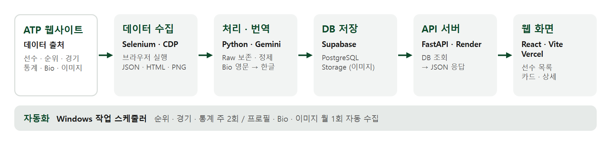
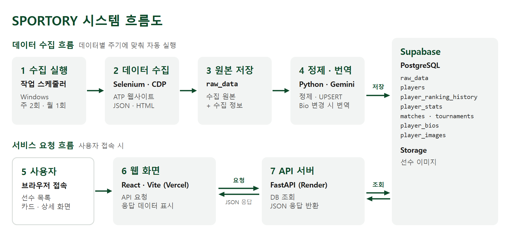
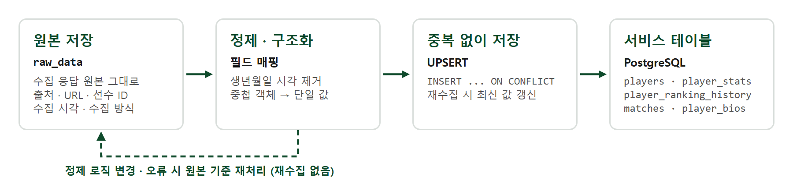
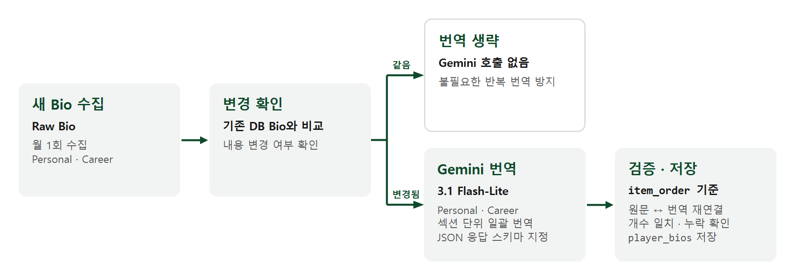
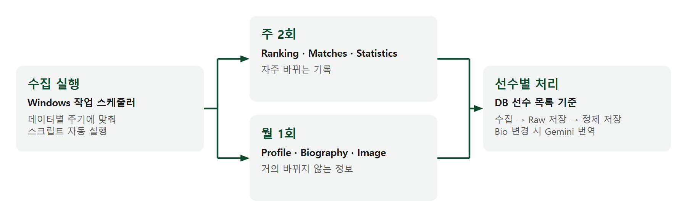

<div align="center">

# SPORTORY

**크롤링 기반 풀스택 웹 서비스** — 테니스 선수의 기록과 이야기를 함께 제공

**[서비스 바로가기](https://sportory.vercel.app/tennis/players)**

`Python` · `Selenium + CDP` · `PostgreSQL (Supabase)` · `Gemini 3.1 Flash-Lite` · `FastAPI` · `React 19` · `Vite 8`

<br />


</div>

---

## 1. 프로젝트 개요

- **서비스:** 테니스 선수의 기록과 이야기(Biography)를 한 곳에서 제공하는 선수 정보 서비스
- **배경:** 경기 일정 · 순위는 여러 사이트에서 확인 가능, 선수 Biography는 분산되어 한눈에 보기 어려움
- **목표:** ATP 선수 데이터 수집 → 기록 · 이야기 통합 제공, 수집부터 배포 · 자동 수집까지 직접 구축
- **기간:** 2026.09 – 2026.10 (3주)
- **역할:** 개인 프로젝트 — 기획 · 데이터 수집 · DB 설계 · 백엔드 · 프론트엔드 · 배포 · 자동화
- **규모:** 선수 20명 · DB 테이블 8개 · REST API 6개
- **데이터 출처:** [ATP](https://www.atptour.com) 공식 웹사이트 (세계 남자 프로 테니스 선수 · 대회 정보)

| 영역 | 기술 | 사용 이유 |
| --- | --- | --- |
| 데이터 수집 | Python · Selenium · CDP Network 로그 | `requests` 요청 `403` 차단 → 브라우저 기반 수집 |
| 번역 | Gemini API (3.1 Flash-Lite, `google-genai`) | 영문 Biography 한글 번역, Structured Output |
| DB · 저장소 | PostgreSQL (Supabase) · Supabase Storage · psycopg | 원본 · 정제 데이터, 선수 이미지 저장 |
| 백엔드 | FastAPI · Uvicorn · Render | DB 조회 REST API |
| 프론트엔드 | React 19.3 · Vite 8.3 · React Router 7.18 · Vercel | 선수 목록 · 카드 · 상세 화면 |
| 자동화 | Windows 작업 스케줄러 | 데이터별 주기 수집 |

---

## 2. 서비스 구조

<p align="center">
  
</p>

---

## 3. 시스템 흐름도

<p align="center">
  
</p>

- **데이터 수집 흐름:** 작업 스케줄러 실행 → 수집 → 원본 저장 → 정제 · 번역 → Supabase 저장
- **서비스 요청 흐름:** 웹 화면 → FastAPI → DB 조회 (웹 화면의 DB 직접 접근 없음)

---

## 4. 실제 구현 화면

<p align="center">
  
</p>

---

## 5. 핵심 기능

| 기능 | 핵심 |
| --- | --- |
| [데이터 수집](#5-1-데이터-수집) | 화면 HTML 대신 브라우저가 받는 JSON 응답 수집 |
| [처리 · 저장](#5-2-처리--저장) | 원본 우선 적재 → 정제 → UPSERT |
| [Biography 번역](#5-3-biography-번역) | 변경 감지 + 구조화 응답 + 검증 |
| [자동 수집](#5-4-자동-수집) | 변경 빈도별 수집 주기 분리 |

### 5-1. 데이터 수집

- **이유:** `requests` 요청 `403` 차단, 화면 HTML 파싱은 레이아웃 변경에 취약, 화면 데이터 대부분이 API 응답(JSON)에 존재
- **과정:** 개발자 도구로 데이터 출처 파악, `requests` · Playwright · Selenium 비교 실험

<p align="center">
  
</p>

- **결과:** 프로필 · 순위 · 경기 · 통계 · 이미지 5종 JSON 응답 수집, JSON에 없는 Biography만 HTML 파싱

<details>
<summary>데이터별 확인 경로</summary>

<br />

| 데이터 | 확인 경로 | 형태 |
| --- | --- | --- |
| Profile | `/players/hero/{player_id}` | JSON |
| Ranking | `/rank/history/{player_id}` | JSON |
| Matches | `/activity/sgl/{player_id}/` | JSON |
| Statistics | `/stats/{player_id}/all/all` | JSON |
| Image | `player-gladiator-headshot/{player_id}` | PNG |
| Biography | `.atp_player-bio .tabs` | HTML |

</details>

<details>
<summary>핵심 코드 — CDP Network 로그에서 API 응답 추출</summary>

<br />

[collect_player_stats.py](crawler/collect_player_stats.py)

```python
options.set_capability("goog:loggingPrefs", {"performance": "ALL"})   # Network 로그 활성화
driver = webdriver.Chrome(options=options)
driver.execute_cdp_cmd("Network.enable", {})

driver.get(stats_page_url)
performance_logs = driver.get_log("performance")

for log in performance_logs:
    message = json.loads(log["message"])["message"]
    if message["method"] != "Network.responseReceived":
        continue

    response = message["params"]["response"]
    if target_pattern not in response.get("url", ""):         # 통계 API 응답만 필터링
        continue

    body_result = driver.execute_cdp_cmd(                      # requestId로 응답 본문 조회
        "Network.getResponseBody",
        {"requestId": message["params"]["requestId"]}
    )
    stats_data = json.loads(body_result["body"])
    break
# (base64 디코딩, 예외 처리, 로그 출력 생략)
```

</details>

### 5-2. 처리 · 저장

- **이유:** 수집 즉시 정제하면 정제 규칙 변경 시 재수집 필요, 주기적 재수집 시 중복 저장 방지 필요

<p align="center">
  
</p>

- **결과:** 정제 규칙이 바뀌어도 재수집 없이 원본으로 재처리, 키 기준 UPSERT로 재실행해도 결과 동일

### 5-3. Biography 번역

- **이유:** ATP Biography 영문만 제공 → 한글 번역 필요, 월 1회 재수집 시 변경 없는 원문 반복 번역 → API 비용 낭비

<p align="center">
  
</p>

- **결과:** 영문 · 한글 Biography 제공, 변경 없는 선수는 Gemini 호출 생략

| 영어 (수집 원문) | 한국어 (Gemini 번역) |
| --- | --- |
|  |  |

<details>
<summary>핵심 코드 — LLM Structured Output과 응답 검증</summary>

<br />

[translate_player_bio.py](crawler/translate_player_bio.py) · [check_bio_changed.py](crawler/check_bio_changed.py)

```python
response = client.models.generate_content(
    model="gemini-3.1-flash-lite",
    contents=prompt,
    config=types.GenerateContentConfig(
        temperature=0.2,
        response_mime_type="application/json",
        response_schema={                                    # 응답 스키마 고정
            "type": "ARRAY",
            "items": {
                "type": "OBJECT",
                "properties": {
                    "item_order": {"type": "INTEGER"},
                    "translated_text": {"type": "STRING"}
                },
                "required": ["item_order", "translated_text"]
            }
        }
    )
)

translated_items = json.loads(response.text)

if len(translated_items) != len(texts):                      # 누락 검증
    raise ValueError(f"원문 {len(texts)}개 / 번역 {len(translated_items)}개")

translated_by_order = {                                      # item_order 기준 재매핑
    item["item_order"]: item["translated_text"]
    for item in translated_items
}
```

</details>

### 5-4. 자동 수집

- **이유:** 데이터별 변경 빈도 차이 — 순위 · 경기 · 통계는 잦은 변경, 프로필 · Biography · 이미지는 변경 드묾

<p align="center">
  
</p>

- **결과:** 순위 · 경기 · 통계 주 2회, 프로필 · Biography · 이미지 월 1회 자동 수집 운영

---

## 6. 문제 해결 경험

### 1) 수집: ATP 요청 `403 Forbidden`

- **문제:** `requests`로 페이지 요청 시 `403` 응답
- **원인 분석:** 응답 상태 코드 · 본문 출력으로 비브라우저 요청 차단 확인 ([test_atp_request.py](crawler/test_atp_request.py))
- **해결:** Selenium 브라우저 실행 + CDP Network 로그 기반 응답 수집으로 전환
- **결과:** 프로필 · 순위 · 경기 · 통계 · 이미지 5종 JSON 수집

### 2) 자동화: GitHub Actions에서 통계 응답 수집 실패

- **문제:** 로컬에서는 수집되던 통계 응답이 Actions 환경에서 미수집
- **원인 분석:** 응답 URL 로그 추가, Chrome 실행 옵션 조정으로 원인 범위 축소 시도
- **해결:** Windows 작업 스케줄러로 전환, 상시 실행이 필요한 Python `schedule` 방식도 제외
- **결과:** 주 2회 · 월 1회 자동 수집 운영

<p align="center">
  
</p>

### 3) 번역: 변경 없는 Biography 반복 번역

- **문제:** 월 1회 재수집마다 동일 원문 재번역
- **원인 분석:** 변경 여부와 무관하게 번역 단계 실행
- **해결:** 기존 원문과 섹션별 비교 후 변경 시에만 번역
- **결과:** 변경 없는 선수는 Gemini 호출 생략

### 4) API: 선수 목록 화면 N+1 요청

- **문제:** 목록 조회 후 선수마다 `/rankings?limit=1` 추가 요청
- **원인 분석:** 목록 API가 화면에 필요한 최신 순위 미포함
- **해결:** `/players` 응답에 최신 순위 · 점수 포함 ([커밋](https://github.com/Jenny5789/SPORTORY/commit/2566428))
- **결과:** 목록 화면 요청 N+1회 → 1회, 프론트엔드 요청 로직 단순화

<p align="center">
  
</p>

---

## 7. 한계와 개선 방향

- **로컬 스케줄러 의존:** PC 종료 시 수집 중단 → 클라우드 스케줄링 필요
- **수집 대상 확장:** 선수 추가 절차는 [ADD_PLAYER_GUIDE.md](docs/ADD_PLAYER_GUIDE.md)로 정리, 대상 확대 시 수집 시간 증가 대응 필요
- **테스트 부재:** 정제 · 매핑 함수 단위 테스트로 외부 스키마 변경 조기 감지 필요

---

<details>
<summary><b>API · DB 테이블</b></summary>

<br />

| Method | Endpoint | 설명 |
| --- | --- | --- |
| GET | `/players` | 선수 목록 + 최신 순위 · 점수 |
| GET | `/players/{player_id}` | 선수 상세 정보 · 이미지 URL |
| GET | `/players/{player_id}/bio` | Biography (영문 · 한글) |
| GET | `/players/{player_id}/rankings` | 순위 이력 |
| GET | `/players/{player_id}/stats` | 통계 |
| GET | `/players/{player_id}/matches` | 경기 · 대회 정보 |

| 테이블 | 역할 |
| --- | --- |
| `raw_data` | 수집 원본 · 수집 정보 |
| `players` | 선수 기본 정보 |
| `player_images` | 선수 이미지 경로 |
| `player_ranking_history` | 순위 · 점수 이력 |
| `player_stats` | 선수 통계 |
| `matches` · `tournaments` | 경기 · 대회 정보 |
| `player_bios` | Biography 원문 · 번역 |

</details>

<details>
<summary><b>실행 방법 · 폴더 구조</b></summary>

<br />

**환경 변수** (`.env`, 저장소 미포함)

```env
DB_HOST=
DB_PORT=
DB_NAME=
DB_USER=
DB_PASSWORD=
GEMINI_API_KEY=
```

**백엔드**

```bash
pip install -r requirements.txt
uvicorn backend.main:app --reload
```

**프론트엔드** (`VITE_API_BASE_URL` 미설정 시 `http://127.0.0.1:8000`)

```bash
cd frontend
npm install
npm run dev
```

**데이터 수집**

```bash
python crawler/get_players_from_db.py      # 주 2회: Ranking · Matches · Statistics
python crawler/run_monthly_player_data.py  # 월 1회: Profile · Bio · Image
```

```text
SPORTORY/
├── crawler/            # 수집 · Raw 적재 · 정제 · 번역 스크립트
│   └── experiments/    # 수집 방식 검증용 테스트 코드
├── backend/            # FastAPI (main.py · routers/)
├── frontend/           # React · Vite
├── docs/               # README 이미지 · 도식 원본(diagrams/) · 가이드
└── requirements.txt
```

</details>

---

## 8. 프로젝트를 통해 얻은 경험

> **데이터 수집부터 DB · API · 웹 화면 · 배포 · 자동 수집까지 서비스 전체 1인 설계 · 구현**

| 역량 | 경험 |
| --- | --- |
| **데이터 소스 분석** | 개발자 도구로 화면 데이터 출처(API 응답 · HTML) 파악 → 수집 방식 설계 |
| **브라우저 기반 수집** | Selenium + CDP Network 로그로 JSON 응답 수집, 봇 차단(`403`) 대응 |
| **ELT 파이프라인** | Raw 적재 → 정제 · 정규화 → UPSERT, 원본 기반 재처리 구조 |
| **LLM 연동** | Structured Output(JSON Schema) · 응답 검증, 변경 감지로 호출 최소화 |
| **REST API 설계** | 화면 단위 응답 설계로 N+1 요청 제거 |
| **배포 · 운영** | Supabase · Render · Vercel 배포, Windows 작업 스케줄러 자동 수집 |

**배운 점**

- 수집 방식을 바꾸기 전에 응답을 직접 확인해 원인부터 특정하는 접근
- 원본 저장과 정제를 분리해 재처리 가능한 구조를 먼저 설계하는 것의 가치
- AI 번역 결과는 응답 형식 고정과 검증을 거쳐야 서비스 데이터로 쓸 수 있다는 점

<br />

<div align="center">

**[SPORTORY 서비스 바로가기](https://sportory.vercel.app/tennis/players)**

</div>
